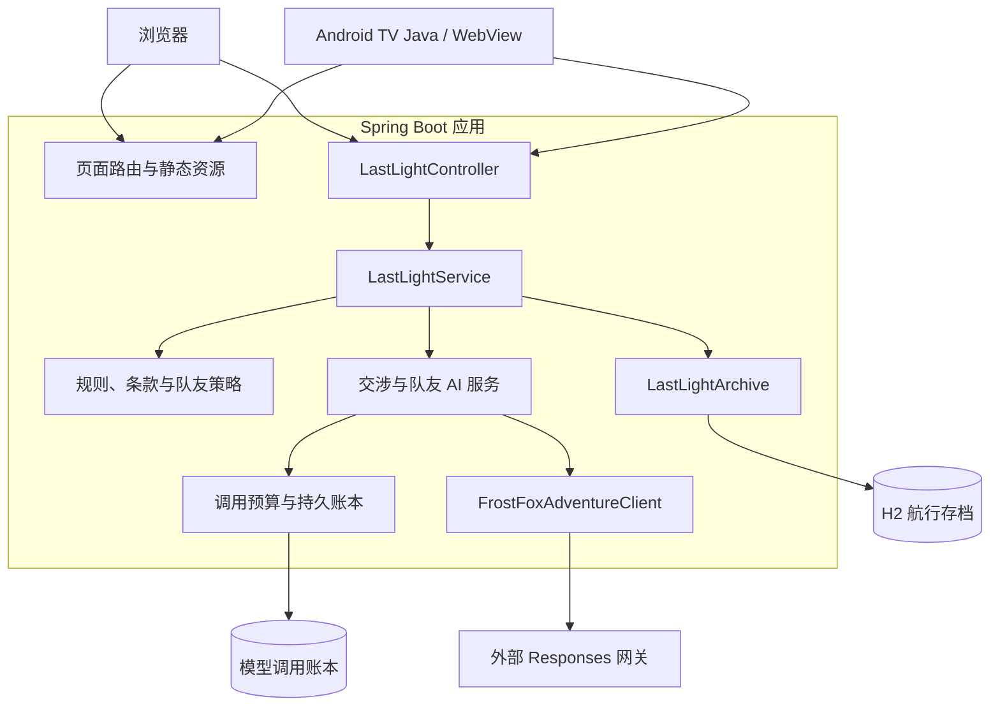
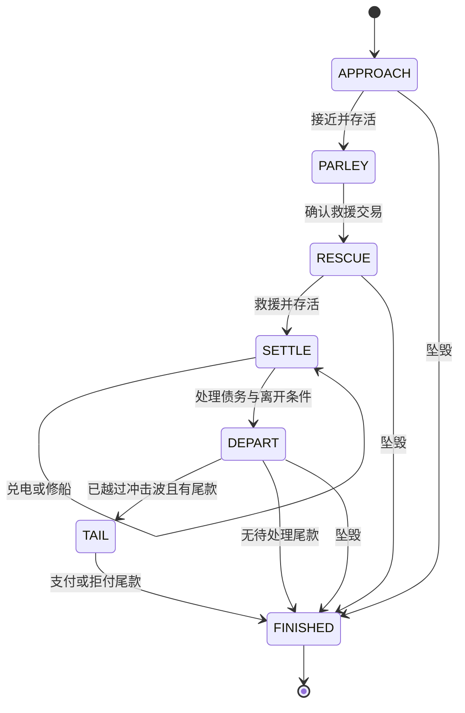
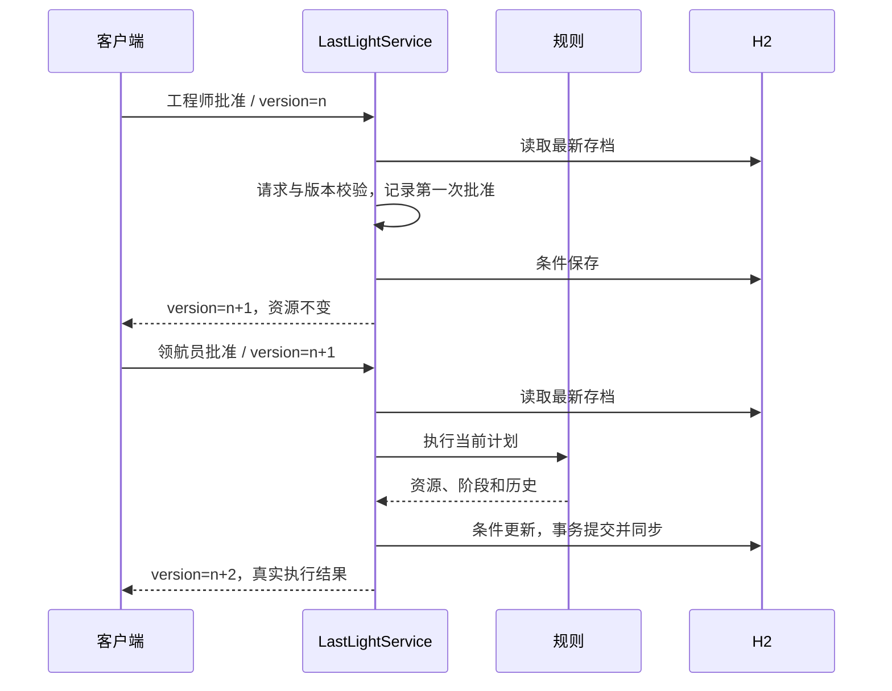
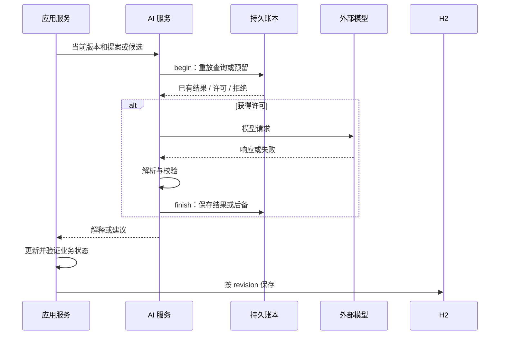

# Living Room Quest 技术架构：权威状态、受约束 AI 与多端交互

Living Room Quest 基于 Java 21 与 Spring Boot 构建。《最后一盏灯》是当前统一游玩入口：玩家通过工程师、领航员两个岗位处理救援任务，提出交易、形成承诺并执行行动。浏览器与 Android TV 客户端共享后端规则、存档和模型适配。

系统将游戏事实、交涉表达和客户端交互分开。Java 决定资源、合法条款和结局；模型解释提案、表达角色态度并提供受约束建议；客户端展示后端视图并提交操作。模型回答不会直接成为游戏状态，界面点击也不直接代表结算成功。

本文以 `feature_v1` / `b2d5aae` 源码说明系统结构、状态模型、数据流和一致性机制，核对日期为 2026-10-27。

## 1. 总体架构与部署结构

项目采用单体部署：Spring Boot 同时提供静态页面和 HTTP API，H2 保存航行快照，本地持久账本保存模型调用。Android TV 应用是 Java/WebView 外壳，不维护另一套游戏引擎。



系统存在两个持久化边界：游戏存档记录已经接受的状态与请求，调用账本记录模型预留及结果。游戏写入失败后，模型结果可以独立恢复。二者没有与外部供应商组成分布式事务。

| 层次 | 当前实现 |
| --- | --- |
| 后端 | Java 21、Spring Boot 3.5.16、Spring MVC |
| 数据访问 | Spring JDBC、Jackson、H2 2.5.252 |
| Web | HTML、CSS、JavaScript，无独立前端框架运行时 |
| TV | Android Java Activity、WebView、原生按键 |
| 剧情 AI | FrostFox Responses 网关，代码中的模型标识为 `gpt-6-sol` |
| 保留的云端适配 | AWS SDK for Java 2.x 2.55.11 与 Bedrock 相关实现 |
| 构建与测试 | Maven、JUnit / Spring Boot Test、Node.js 客户端测试、PowerShell TV 构建脚本 |

版本依据：`pom.xml`。当前 Last Light 交涉使用 FrostFox 适配器，仓库中的 Bedrock 实现属于另行保留的适配路径。

## 2. 后端分层与模块职责

项目通过普通 Java 类和包划分职责，没有引入独立领域框架或通用工作流引擎。

| 模块 | 核心类型 | 职责 |
| --- | --- | --- |
| 接口层 | `LastLightController` | 创建、读取和动作 HTTP 合同 |
| 应用服务 | `LastLightService` | 请求校验、版本检查、规则与 AI 调用、保存编排 |
| 状态模型 | `LastLightState` | 一局航行的资源、阶段、计划、承诺和请求记录 |
| 游戏规则 | `LastLightRules` | 合法选项、执行预览、物理行动、结局和状态约束 |
| 交涉规则 | `LastLightProposal`、`LastLightNegotiation`、`LastLightDeals` | 提案语义、规则还价、交易校验与执行 |
| 队友策略 | `LastLightTeammate` | 候选模拟、本地选择、受限在线建议应用 |
| AI 服务 | `LastLightAiService`、`LastLightTeammateAiService` | 上下文、预算、输出校验、重放和回退 |
| 传输适配 | `FrostFoxAdventureClient`、`FrostFoxHttpTransport` | 供应商协议与网络行为 |
| 存档 | `SessionArchive`、`LastLightArchive` | 快照读写、事务、修订号与载荷校验 |

`LastLightService` 通过 `SessionArchive` 表达存档操作，Spring 注入实际 JDBC 实现，测试可以替换存档。当前 AI 服务则直接依赖 FrostFox 适配器，并没有把所有供应商做成完全可互换的统一接口。

规则层不访问 DOM、不发 HTTP；客户端不自行裁定交易成立；模型传输层不直接写游戏存档。这使一套规则既能用于真实行动，也能用于队友模拟和规则测试。

实现位置：`LastLightService`、`SessionArchive`。

## 3. 航行状态模型与状态机

### 3.1 一局航行作为状态边界

`LastLightState` 集中保存一局游戏的事实。选择、批准、交涉和结算都在这个状态边界中完成。

| 类别 | 代表字段 | 作用 |
| --- | --- | --- |
| 标识与版本 | `gameId`、`version` | 找到航行，判断页面操作版本 |
| 玩法与岗位 | `playMode`、`playerRole`、`teammate` | 单人或双人，以及真人与队友分工 |
| 阶段 | `stage` | 限定当前操作范围 |
| 物理资源 | `power`、`hull`、`module`、`tugPower` | 双方船舶能源、船体和模块 |
| 救援事实 | `passengers`、`aid`、`late`、`tugOnboard`、`auroraReturned` | 援助、乘客、时间与返航情况 |
| 承诺与债务 | `pledged`、`pledgeBroken`、`baseDebt`、`baseStatus`、`escortDue`、`escortStatus` | 抵押、违约、救援债和护航尾款 |
| 当前计划 | `engineer`、`navigator`、`offer` | 岗位方案或交易草案 |
| 批准 | `engineerApproved`、`navigatorApproved` | 当前计划是否获得确认 |
| 记录 | `history`、`memories`、`requests` | 航行历史、叙事事实和请求签名 |

承诺不只存在于对白。`pledgeBroken` 改变后续延期付款条件，`escortDue` 决定离开后是否仍需处理尾款。`memories` 保存双语事件说明，真正的交易约束仍读取资源与债务字段。

### 3.2 阶段流转

状态机通过 `stage` 字符串、规则分支和 `advance` 方法实现：



这是主阶段图。选择方案、第一次批准、提出草案和询问事实，都可以只更新阶段内部状态。`advance` 进入下一阶段时清空方案、草案和批准，防止上一阶段的操作继续生效。

### 3.3 合法性、危险与结局

`options` 根据阶段与状态生成合法选项，`preview` 说明组合行动后的资源和风险，`execute` 执行实际变化。

危险与非法分开处理：合法选择即使会耗尽能源，也可以显示风险并由玩家确认；执行后资源收敛到非负值，进入失败结局。非法选项则在选择或条款校验时被拒绝。

结局根据 Aurora 是否返航、站内人数、灯塔号是否返航或等待救援等事实计算。八人全部返航不是一句生成对白，而是确定的状态条件。

实现位置：`LastLightState`、`LastLightRules`。

## 4. 请求模型与一次动作的执行过程

### 4.1 HTTP 合同

| 方法 | 路径 | 行为 |
| --- | --- | --- |
| `POST` | `/api/last-light/games` | 创建或恢复同一创建编号的航行 |
| `GET` | `/api/last-light/games/{gameId}` | 读取已保存视图 |
| `POST` | `/api/last-light/games/{gameId}/actions` | 提交选择、批准、交涉或队友评估 |

创建请求的 `requestId` 同时作为航行标识。重复创建时核对已有玩法与岗位，不能用同编号改成另一种玩法。

动作请求由一个 record 定义：

```java
public record Request(
    String requestId,
    Integer version,
    String action,
    String role,
    String optionId,
    String text
) { }
```

`SELECT`、`APPROVE`、`PROPOSE`、`ASK`、`TEAMMATE` 和 `ASSIGN_ROLE` 共用动作入口，按动作检查字段组合。状态写入集中在应用服务，版本与幂等规则不会分散到多个控制器。

### 4.2 服务处理顺序

`LastLightService.act` 按以下顺序工作：

1. 校验请求编号、版本、动作、岗位与附加字段。
2. 加载最新存档，验证状态完整性。
3. 对已处理编号核对请求签名；一致则返回已保存视图。
4. 对新请求检查业务版本、终态和操作数限制。
5. 分发动作，按需要刷新队友策略。
6. 推进版本、记录请求签名，再次验证状态。
7. 按原数据库修订号保存。
8. 保存成功后构造响应视图。

重复请求检查先于版本检查。原操作执行后版本已经推进，响应却可能丢失；携带旧版本的原请求应被识别为重试，而非再次执行或误判为新的旧版本操作。

### 4.3 选择、批准、结算分离

双人模式第一次批准只记录确认，不扣资源；第二岗位也批准时才执行。修改任一选择或生成新草案会清除旧批准。

单人模式由真人一次确认执行两个岗位方案，队友不自行批准。



岗位检查是同屋协作玩法规则，不等同于独立账号、身份认证和权限系统。

实现位置：`LastLightController`、`LastLightService`。

## 5. 存档结构与状态一致性

### 5.1 完整快照

`last_light_archive` 一行保存一局航行：

| 字段 | 类型 | 作用 |
| --- | --- | --- |
| `mode` | `VARCHAR(8)` | 固定为 `LIGHT` |
| `game_id` | `VARCHAR(64)` | 与 mode 组成主键 |
| `revision` | `BIGINT` | 数据库并发修订号 |
| `format_version` | `INTEGER` | 载荷格式，当前为 1 |
| `payload` | `CLOB` | 完整状态 JSON |
| `created_at`、`updated_at` | 带时区时间戳 | 创建与更新时间 |

资源、草案、批准、历史和请求签名在一个快照中提交。恢复时无需逐条重放动作。`history` 是快照里的业务记录，不是独立事件存储，因此当前没有采用事件溯源。

### 5.2 三个版本各司其职

| 字段 | 解决的问题 |
| --- | --- |
| 状态 `version` | 客户端是否基于最新业务状态操作 |
| 表列 `revision` | 读取后是否有其他写入者修改同一行 |
| 表列 `format_version` | 程序是否支持读取该格式 |

正常动作往往同时推进业务版本与数据库修订号，但前者是 HTTP 合同，后者是存档并发协议，不能只保留一个字段替代两种语义。

### 5.3 条件写入、事务与同步

更新使用参数绑定，核心语句为：

```sql
UPDATE last_light_archive
SET revision = revision + 1,
    payload = ?,
    updated_at = CURRENT_TIMESTAMP
WHERE mode = ?
  AND game_id = ?
  AND revision = ?;
```

影响行数必须为 1，否则返回 `ARCHIVE_CONFLICT`。方法级 `synchronized` 保护当前服务实例，数据库修订号继续保护跨实例写入。

`TransactionTemplate` 与 `DataSourceTransactionManager` 管理事务，并开启提交失败回滚设置。事务提交后执行 `CHECKPOINT SYNC`，再允许正常应答；加载已有记录时也执行同步，处理先前提交完成但同步或响应中断的情况。

因此，客户端收到失败时，数据库可能已经提交。原请求重试会识别快照中的请求记录，读取已保存状态，避免重新扣减。

实例级串行操作和同步落盘服务于本地低频游戏，选择的是较直接的状态一致性路径。模型调用包含在同步动作链路中，当前实现没有采用异步任务队列或高并发会话调度。

### 5.4 请求记录与状态原子提交

`requests` 保存请求编号与序列化请求签名。同编号、同签名不再执行；同编号、不同载荷返回 `REQUEST_ID_REUSED`。

请求记录与资源变化在同一载荷内保存，避免把“已扣资源”和“已处理请求”拆成两个独立写入。重复请求返回当前已保存视图，不承诺原始 HTTP 响应字节完全相同。

### 5.5 载荷校验与兼容

读取时拒绝重复 JSON 字段、尾随内容和必要字段缺失；规则层继续检查资源范围、阶段、岗位与条款。

历史兼容仅允许明确的可选字段缺失，例如旧版没有 `playMode`、`playerRole` 或 `teammate`。显式非法值不能回退成默认值。损坏存档返回错误并保留原记录，不重新创建一局掩盖异常。

实现位置：`表结构`、`LastLightArchive`。

## 6. 交涉模型与 AI 输出约束

### 6.1 提案、还价与执行

```text
玩家提案
  → 本地检查 / 可选在线解释
  → LastLightProposal 结构化语义
  → LastLightNegotiation 按当前事实还价
  → Offer 草案
  → 玩家批准
  → LastLightDeals 校验与执行
```

结构化提案表达意图、当前支付、延期支付、模块、座位与护航请求。规则层依据资源、阶段和信用决定真实还价。

`Offer` 用 `cashNow`、`cashLater`、`moduleNow`、`seats` 保存执行数据，同时提供双语标题、条款与警告。对白和执行参数分开，防止文本写了一个金额、程序却执行另一个金额。

例如护航与原救援债分别计算；已经破坏抵押承诺时，延期付款提案会被规则改成现付还价。玩家换一种措辞不会清除 `pledgeBroken`。

### 6.2 事实上下文与结构化生成

`LastLightAiContext` 从当前状态构造模型输入，带上资源、历史与承诺事实，说明 SOLO 或 DUO 的确认规则。`LastLightAiPrompt` 使用严格 JSON Schema，约束意图枚举、金额、座位、布尔值和固定字段集合。

模型输出仍要经过本地解码和业务校验。角色对白限制长度、控制字符、格式标记，以及擅自声称已执行、免债等表达；记忆标记必须匹配后端事实。

角色表达避免自行陈述数值，完整费用与还价由 Java 生成。服务将模型态度和规则还价组合展示，语言表达可以变化，条款权威保持在规则层。

当前本地提案检查先于在线调用，不支持的语义会先被拦截。系统提供的是受约束交涉，而非任意自然语言动作执行。

实现位置：`LastLightProposal`、`LastLightNegotiation`、`LastLightDeals`、`LastLightAiContext`、`LastLightAiPrompt`。

## 7. 单人队友的候选模拟

`LastLightTeammate` 提供免费本地配合，显式在线评估作为附加路径。

玩家选择自己的方案后，策略枚举另一岗位当前合法选项。每个候选复制一份状态，调用同一个 `LastLightRules.execute`，比较实际即时后果，再结合后续条件形成返航估算。

```text
真人选择
  → 枚举队友合法选项
  → 复制状态并逐项执行模拟
  → 比较安全性、乘客、能源与船体
  → 本地建议 / 在线候选上下文
  → 校验并应用建议
  → 真人确认真实执行
```

排序优先考虑安全性，再考虑乘客、能源和船体。当前步骤模拟使用真实规则；未来交涉估算带有条件，不把尚未成交的安排当成历史事实。

在线模型只能从提供的候选中选择。返回后再次核对候选标识和表达，非法结果回退本地策略；仅一个合法候选时不请求模型。

这一设计复用了规则执行器，避免另写一套与真实游戏脱节的建议数值。模拟仅作用于复制状态，建议本身不修改真实资源，也不产生批准。

实现位置：`LastLightTeammate`、`LastLightTeammateAiService`。

## 8. 模型调用账本与恢复机制

### 8.1 调用入口与预算

`FrostFoxAdventureClient` 封装供应商协议，当前请求超时为 25 秒，最大输出为 512 token。浏览器动作请求等待上限为 35 秒，读取为 15 秒；这些是代码中的等待配置，不是实际延迟指标。

交涉和队友服务先完成配置、输入及上下文检查，再申请调用许可。`BedrockUsageBudget` 沿用历史类名，但有 FrostFox 独立账本构造路径。

预算检查累计、UTC 日、每局次数、预算和未完成调用。关闭 AI、唯一候选或配置不满足时走本地路径。

### 8.2 预留、调用与完成



条目记录航行、版本、进程身份、预留与结果。预留先于网络请求持久化，已完成结果可重放；活进程持有的预留阻止并发调用，确认原进程退出后恢复中断后备。

`BedrockUsageLedger` 在文件锁内读取、校验和更新，锁不跨远程请求持有。文件写入使用同目录临时文件、`force(true)` 与原子替换，防止读到部分 JSON。

账本结构或锁标记不完整时拒绝收费调用，不创建空账本覆盖历史。预留属于本应用预算控制，不等于供应商实际账单。

### 8.3 为什么账本独立于游戏快照

模型可能已经完成，而后续游戏存档失败。重试原动作时，游戏仍在原版本，AI 服务从账本取回结果，避免再发一次相同请求。

交涉缓存关联提案指纹；队友缓存关联上下文指纹，重放时继续校验岗位和候选。同版本被换成另一份输入时返回冲突，不复用不相关结果。

该机制通过持久结果衔接两次保存，没有假定外部推理与 H2 存在共同事务，也没有把超时解释成供应商一定未处理。

实现位置：`LastLightAiService`、`BedrockUsageBudget`、`BedrockUsageLedger`、`FrostFoxAdventureClient`。

## 9. Web 客户端的数据流

### 9.1 服务端视图驱动渲染

后端 `View` 提供资源、草案、批准、合法选项、费用、预览、队友来源和结局。浏览器展示这些字段，不重新实现交易规则。

`LastLightClient` 在接受响应前检查阶段、数值、双语文本、选项和终态结构。HTTP 200 但数据不完整时，不发布为有效快照。

### 9.2 先保留意图，再发请求

`send` 生成编号，在发送前保存 `{gameId, payload}`。有待处理请求时不叠加新动作；`retry` 保留原编号、版本和完整载荷。

```text
生成请求 → 保存 pending 与快照 → HTTP 发送
         → 校验响应 → 更新会话并清理 pending
```

响应丢失后原载荷仍可重试。显式同步读取服务端状态，并按设计放弃本页未确认意图。创建航行同样先保存编号和玩法，避免首次响应丢失后重复开局。

### 9.3 页面绑定与持久恢复

`SessionStore` 将最新存档指针、持久待处理请求与标签页指针分开。其他标签页新开局，不直接改变本页绑定；刷新或关闭页面后，可以尝试恢复未确认请求。

浏览器存储保存恢复线索，服务端存档才是游戏事实来源。数据同步不依赖浏览器资源条的旧值。

双语核心文本由 `Text(zh, en)` 表达，换语言只是展示变化，不提交新游戏动作。同步、刷新和切语言也不应被当作一次新的行动成功反馈。

实现位置：`last-light-client.js`、`session-store.js`、`last-light-render.js`、`last-light.js`。

## 10. Android TV 与遥控交互

Android 外壳负责 TV 入口、WebView、遥控事件、原生错误页与 Retry。输入分三层处理：

| 层次 | 职责 |
| --- | --- |
| Android | D-pad Center / 手柄 A 映射 Enter，过滤长按重复事件，处理 Back |
| Web 焦点 | 方向导航、分区、目标可见性和返回焦点恢复 |
| 游戏交互 | 根据焦点提交选择或批准，由后端决定真实结果 |

确认键以原生 Enter 分发，不额外执行 JavaScript click。重复 DOWN 在进入 WebView 前被消耗，防止焦点交接后长按继续批准另一岗位。

Back 在游戏中转换成 Escape；位于无弹层的欢迎界面时退出 Activity。页面无法加载时使用原生错误界面，恢复入口不依赖尚未加载的 JavaScript。

开发运行通过 ADB reverse 将 TV 回环端口连接本机后端。后端默认监听 `127.0.0.1`，外壳限制顶层导航到配置回环源，没有 JavaScript-to-Java 接口。

布局依据实际 CSS 视口而非面板分辨率。焦点目标滚动到可见位置，长交涉内容在区域内滚动，主要确认操作保持可达。

实现位置：`MainActivity`、`tv-focus.js`、`last-light.css`、`TV 运行说明`。

## 11. 启动、资源版本与错误协议

### 11.1 首次创建与已有数据分开

普通 main 在 Spring 初始化阶段调用 `FirstRunStartup`。仅为确实不存在的默认数据库创建存档结构，仅在账本和锁标记均不存在时创建初始账本。

初始化通过跨进程锁重复检查条件，在暂存目录创建完整数据库，再以不覆盖方式发布。已有库不自动迁移，显式自定义路径不自动准备，中断残留不直接覆盖。

首次建库与数据库升级因此保持独立，避免每次启动反复执行一次性 SQL。

### 11.2 统一入口与缓存

`PageController` 将旧故事、舰桥和冒险页面转到 `/play/last-light`；历史接口与存档保留。

`BrowserCacheFilter` 对页面和 API 设置 `no-store`，其他资源设置 `no-cache, must-revalidate`，并返回 `X-Aurora-Build`。浏览器重新确认静态资源版本，降低脚本、页面和接口混用不同构建的可能。

### 11.3 统一异常合同

业务异常返回 `{code, message}` 并保留状态：输入错误 400、状态或写入冲突 409、存档不可用 503。损坏存档与一般冲突分开表达。

协议异常保留框架状态和响应头，避免统一兜底把 405、415 改成 500。客户端可据此区分修正输入、同步状态与原请求重试。

实现位置：`FirstRunStartup`、`PageController`、`BrowserCacheFilter`、`ApiErrorHandler`。

## 12. 架构约束与测试对应

下表按测试源码列出各项架构约束的验证入口，说明测试的设计职责，不将测试定义等同于新的运行结果。

| 架构约束 | 测试入口 |
| --- | --- |
| 修改方案撤销批准、重复动作不重复结算、旧版本不能覆盖 | `LastLightDurabilityTest` |
| 写失败不发布半结算，重启恢复草案、承诺与请求 | `LastLightDurabilityTest`、`LastLightCrashRecoveryTest` |
| 低资源执行后的失败语义 | `LastLightDangerTest` |
| 模型不能宣告执行、免债或输出非法格式 | `LastLightAiAuditTest` |
| 独立进程生成相同的规范上下文 | `LastLightTeammateContextTest` |
| 首次创建、部分文件和并发启动保护 | `FirstRunStartupTest` |
| 请求、恢复、响应校验与重试 | `last-light-client.test.cjs`、`session-store.test.cjs` |
| 方向导航与交涉焦点 | `tv-focus.test.cjs`、`last-light-talk-focus.test.cjs` |

规则决定后果，批准决定执行时机，事务决定何时接受状态，账本决定模型结果如何恢复，客户端负责可靠传递用户意图。各层围绕同一份权威状态协作，构成当前游戏的完整操作链路。


相关实践：[从 AWS Bedrock 接入失败，到建立第三方服务的前置验证机制](./%E4%BB%8E%20AWS%20Bedrock%20%E6%8E%A5%E5%85%A5%E5%A4%B1%E8%B4%A5%EF%BC%8C%E5%88%B0%E5%BB%BA%E7%AB%8B%E7%AC%AC%E4%B8%89%E6%96%B9%E6%9C%8D%E5%8A%A1%E7%9A%84%E5%89%8D%E7%BD%AE%E9%AA%8C%E8%AF%81%E6%9C%BA%E5%88%B6.md)。
